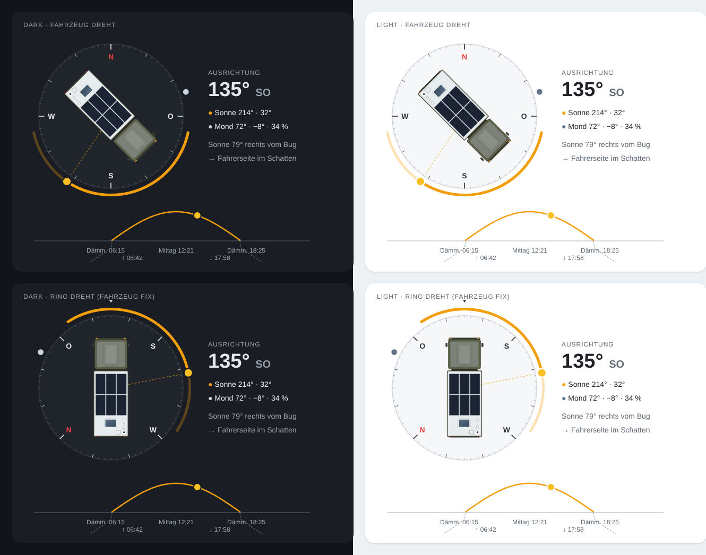
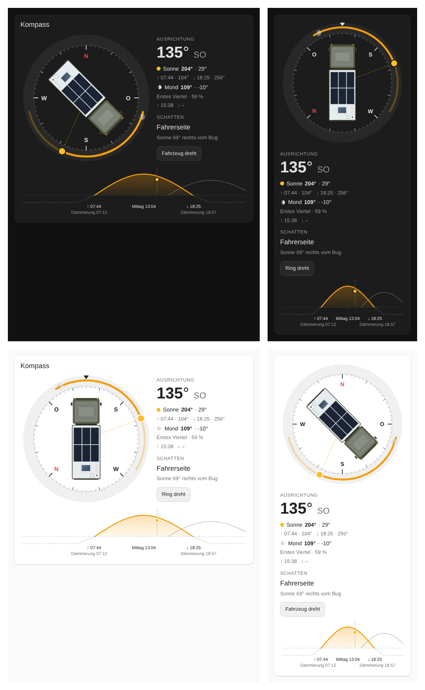
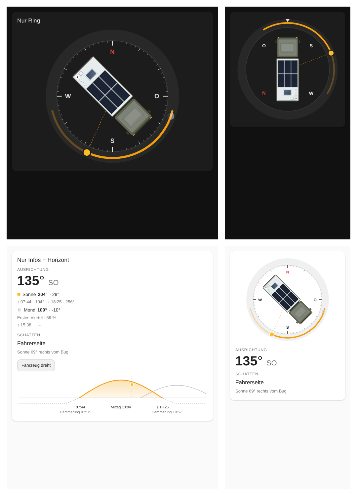

# Dashboard (Ziel 2)

## Fahrzeuggrafik

| Datei | Verwendung |
| --- | --- |
| `assets/nx01-top.svg` | Vektor-Draufsicht, Front oben, Maßstab 1 px = 10 mm, Drehpunkt (122.5, 349.5) – für Lovelace (Smartphone, Tablet, PC) |
| `assets/nx01-top-{120,180,240,360}.png` | transparente PNG-Exporte in fester Höhe – für openHASP (`img`-Objekt, Drehung über `angle`) |

Nachgezeichnet nach Drohnenaufnahmen (Tunesien), der Dachkamera und den Fahrzeugmaßen (6990 × 2450 mm):

- Fahrerhaus mit mittiger Dachprofilierung (Sicken)
- Wohnkoffer mit 6 Solarmodulen (2 × 3) und Dachfenster
- rechts in einer Flucht, von vorn nach hinten: 5G-Antenne (weiß), WiFi-Antenne (weiß), Kathrein HDZ 100 Kabel-Dachdurchführung
- Heck rechts: LoRa-Magnetfußantenne auf weißem Blech 35 × 35 cm, links daneben Starlink Mini

## Konzept



- Kompassring mit Himmelsrichtungen; konfigurierbar: **Fahrzeug dreht** (Nord oben) oder **Ring dreht** (Fahrzeug fix, Fahrtrichtung oben)
- helles und dunkles Design (folgt dem HA-Theme)
- Horizontstreifen mit Sonnenhöhe über den Tag, Dämmerung, Auf-/Untergang, Mittag (ersetzt die Horizon Card)
- Sonnenbahn des Tages (Aufgang → Untergang) mit aktueller Sonnenposition
- Mondposition und -phase
- Text: Ausrichtung, Sonnen-/Mondstand, Sonne relativ zum Fahrzeug („Fahrerseite im Schatten“)

Die Mockup-Werte sind Beispielwerte.

## Architektur

```
HA-Compass (HACS-Integration, Domain ha_compass)
├── Sensoren für die aktuelle GPS-Position (nicht die HA-Heimatposition):
│   Sonne: Azimut, Höhe, Dämmerung, Aufgang, Mittag, Untergang
│   Mond:  Azimut, Höhe, Phase, Beleuchtung, Auf-/Untergang
│   relativ zum Fahrzeug: Sonnenwinkel zum Bug, beschattete Seite
├── Lovelace-Karte ha-compass-card (wird von der Integration mitgeliefert und registriert)
└── openHASP-Seite 480 × 480 (Vorlage)
```

Eine eigene Integration ist nötig, weil die HA-Integrationen `sun` und `moon` mit der festen Heimatposition rechnen
und keine Mondposition liefern. Im Wohnmobil muss mit der GPS-Position gerechnet werden.

## Lovelace-Karte `ha-compass-card`



Die Karte wird von der Integration mitgeliefert und beim Start automatisch als Dashboard-Ressource (`/ha_compass/ha-compass-card.js`, JavaScript-Modul) eingetragen – keine separate HACS-Installation. Bei Dashboards im YAML-Modus die Ressource von Hand eintragen. Nach Updates einmal die Seite ohne Cache neu laden.
Sie folgt dem HA-Theme (hell/dunkel) und ordnet sich ab ca. 520 px Kartenbreite nebeneinander an, darunter untereinander.

```yaml
type: custom:ha-compass-card
heading_entity: sensor.camper_kompass_ausrichtung_geografisch
title: Kompass
```

Alle Elemente lassen sich einzeln ein- und ausblenden (Standard: alles an) – im visuellen Editor in den Abschnitten *Kompass*, *Infospalte* und *Horizontverlauf*:

| Option | Standard | Wirkung |
| --- | --- | --- |
| `view` | `auto` | `auto` = folgt `select.ha_compass_ansicht`, `vehicle` = Fahrzeug dreht, `ring` = Ring dreht |
| `show_compass` | `true` | Kompass komplett |
| `show_vehicle`, `show_ticks`, `show_cardinals` | `true` | Fahrzeug, Skala, Himmelsrichtungen |
| `show_sun`, `show_sun_path`, `show_moon` | `true` | Sonne mit Richtungsstrahl, Sonnenbahn, Mond |
| `show_bow_marker` | `true` | Markierung „vorne“ im Modus *Ring dreht* |
| `tap_action` | `toggle_view` | `toggle_view` oder `none` |
| `compass_size` | – | maximale Kompassgröße in px |
| `vehicle_image` | – | eigenes Fahrzeugbild (URL, Front oben) |
| `show_info` | `true` | Infospalte komplett |
| `show_heading`, `show_sun_info`, `show_moon_info`, `show_shade`, `show_view_button` | `true` | einzelne Blöcke der Infospalte |
| `show_horizon`, `show_moon_path` | `true` | Horizontverlauf, Mondkurve darin |

Beispiel – nur der Ring für eine Unterseite:

```yaml
type: custom:ha-compass-card
heading_entity: sensor.camper_kompass_ausrichtung_geografisch
show_info: false
show_horizon: false
```



Tippen auf den Kompass oder den Button schaltet die Ansicht um (bei `view: auto` für alle Anzeigen inkl. openHASP).
Die Karte ist auch im visuellen Editor konfigurierbar.
