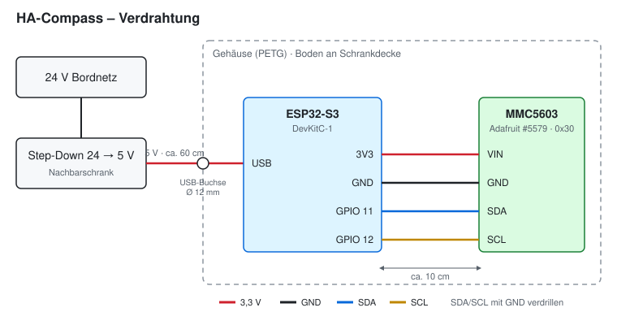

# Hardware

## Bauteile

| Anzahl | Bauteil | Hinweis |
| --- | --- | --- |
| 1 | ESP32-S3-DevKitC-1 | ESP-IDF-Framework |
| 1 | Adafruit MMC5603 Triple-axis Magnetometer (#5579) | I²C-Adresse 0x30, Platine 25,4 × 17,8 mm, 4 Löcher 2,5 mm |
| 1 | Step-Down-Wandler 24 V → 5 V | im Nachbarschrank, ca. 60 cm vom Sensor |
| 1 | USB-Einbaubuchse rund (12 mm) | 5-V-Zuführung ins Gehäuse |
| 4 | Messing-Einschmelzmutter M2,5 | Sensorbefestigung |
| 4 | Nylonschraube M2,5 × 6 | Sensorbefestigung – **nicht magnetisch** |
| 4 | Messing-Einschmelzmutter M3 | Deckel |
| 4 | Nylonschraube M3 × 8, Flachkopf | Deckel |
| 4 | Holz-/Messingschraube ca. 4 mm | Gehäuse an Schrankdecke (am Sensor-Ende Messing/Nylon) |

## Verdrahtung

| MMC5603 | ESP32-S3 | Funktion |
| --- | --- | --- |
| VIN | 3V3 | Versorgung 3,3 V |
| GND | GND | Masse |
| SDA | GPIO 11 | I²C-Daten |
| SCL | GPIO 12 | I²C-Takt |

Versorgung des ESP: 24 V Bordnetz → Step-Down 5 V → USB-Einbaubuchse → USB des ESP32-S3.

Empfehlungen:
- SDA und SCL jeweils mit einer GND-Ader verdrillen.
- Sensor und ESP an entgegengesetzten Enden des Gehäuses (ca. 10 cm Abstand).
- Den Step-Down-Wandler **nicht** ins selbe Fach setzen – seine Speicherdrossel erzeugt ein lastabhängiges Magnetfeld (≥ 30 cm Abstand).

## Gehäuse

Datei: [`hardware/gehaeuse/camper-kompass-gehaeuse.scad`](../hardware/gehaeuse/camper-kompass-gehaeuse.scad) (OpenSCAD, parametrisch)

- Innenmaß 130 × 45 × 28 mm, Wandstärke 2,5 mm, Druck in PETG oder ASA
- 4 Abstandshalter (5 mm) mit Einschmelzmuttern M2,5 für den MMC5603
- 4 Ecksäulen mit Einschmelzmuttern M3, Deckel verschraubt
- Befestigungsflansch mit 4 Löchern am Gehäuseboden
- Lüftungsschlitze im Deckel gegen Kondenswasser
- Pfeil „FRONT“ im Deckel

### Einbauvarianten

Der Parameter `einbau` wählt die Variante. Gehäuse und Deckel unterscheiden sich nur in der Lage der Sensorplatine und im Pfeil:

| `einbau` | Gehäuse im Fahrzeug | Sensorplatine | Pfeil „FRONT“ im Deckel |
| --- | --- | --- | --- |
| `"laengs"` | Längsachse in Fahrtrichtung | quer (90°) | zur Stirnseite; `vorne_ist_sensorseite` wählt, welche |
| `"quer"` | quer zur Fahrtrichtung, lange Seite nach vorne | längs (0°) | zu einer Längsseite |

Hintergrund: Auf dem Adafruit-Board steht der X-Pfeil quer zur langen Platinenkante, und X muss immer zur Fahrzeugfront zeigen.
Beim Quereinbau dient die lange Gehäusekante als Anschlag – damit lässt sich das Gehäuse genauer rechtwinklig zur Fahrzeugachse ausrichten.
Deckel und Sensorplatine lassen sich jeweils um 180° gedreht montieren; entscheidend ist nur, dass Deckelpfeil und X-Pfeil auf der Platine in dieselbe Richtung zeigen.

Heißkleber nur für den ESP oder als Zugentlastung verwenden – **nicht** für den Sensor. Unter der GfK-Decke wird es im Sommer warm genug, dass Heißkleber kriecht, und jede Lageänderung des Sensors nach der Kalibrierung verfälscht die Ausrichtung.

## Montage im Fahrzeug

**Einbauort:** Heck, Oberschrank (Pappelsperrholz), direkt unter der GfK-Decke, ca. 3,6 m von der Haupttechnik. Versorgungsleitungen verlaufen 2,3 m tiefer am Boden.

Bewertung der Umgebung:
- Alu-Profile, GfK, Sperrholz: unmagnetisch, unkritisch
- RUTX50 (20 cm), 5G-Antenne (30 cm), Scharniere (15 cm): konstante Störung, wird durch die Kalibrierung herausgerechnet
- Funkgeräte: Großgeräte im Fahrerhaus, nur während der Fahrt; Kleinsender ≥ 4 m – unkritisch

**Einbaulage:** Boden mit Flansch an die Schrankdecke, Deckel nach unten. Der Sensor hängt damit kopfüber – das ändert die Vorzeichen von Y und Z (siehe [Inbetriebnahme](inbetriebnahme.md)).

Regeln:
1. Der **X-Pfeil auf der Platine muss zur Fahrzeugfront zeigen.** Gehäuse, Deckel und Sensor lassen sich jeweils um 180° gedreht montieren.
2. Das Gehäuse muss **parallel zum Wasserwaagen-Sensor** liegen: Fahrzeug so abstellen, dass die Wasserwaage ≈ 0°/0° zeigt, dann das Gehäuse mit einer Wasserwaage ausrichten und ggf. unterlegen. 1° Schräglage zwischen beiden Sensoren ergibt bei uns ca. 2° Fehler in der Ausrichtung.
3. Nach jedem Lösen oder Verschieben die Kreisfahrt-Kalibrierung wiederholen.
