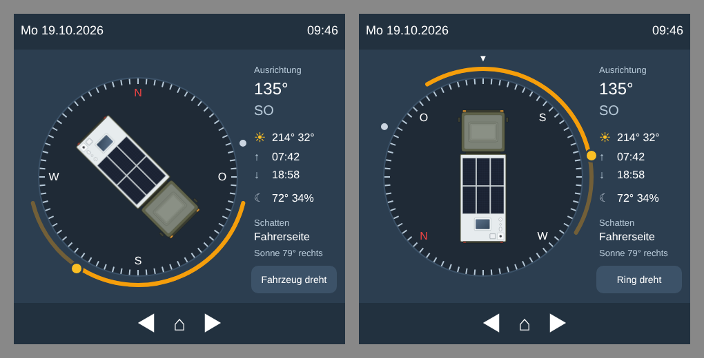

# openHASP-Seite „Kompass“ (480 × 480)

Links der Kompass mit Fahrzeug, Sonnenbahn des Tages, Sonne und Mond; rechts Ausrichtung, Sonnen-/Mondwerte und beschattete Seite.
Der Button unten rechts schaltet `select.ha_compass_ansicht` um (**Fahrzeug dreht** ↔ **Ring dreht**) – dieselbe Einstellung nutzt auch die Lovelace-Karte.

## Dateien

| Datei | Zweck |
| --- | --- |
| `page.jsonl` | Objekte der Seite 9 – an `pages.jsonl` anhängen |
| `openhasp-ha-compass.yaml` | Bindungen für die openHASP-Integration (`configuration.yaml`) |
| `nx01.png` | Fahrzeug 196 × 196 px, transparent – als `L:/nx01.png` auf die Platte laden |
| `generate.py` | erzeugt beide Dateien neu (`python3 generate.py <Plattenname> <Seite>`) |

## Einbau

1. `nx01.png` über die Weboberfläche der Platte (*Datei-Editor*) hochladen.
2. `page.jsonl` an `pages.jsonl` anhängen und die Navigation einhängen:
   `{"page":6,…,"next":9}` und `{"page":1,"id":0,"prev":9}`.
3. Inhalt von `openhasp-ha-compass.yaml` unter der Platte in `configuration.yaml` ergänzen (Plattenname anpassen).
4. HA neu laden (`openhasp.load_pages` bzw. Neustart).

## Voraussetzungen

- Integration **HA Compass** (Sensoren `sensor.ha_compass_*`, `select.ha_compass_ansicht`)
- ESPHome-Kompass: `sensor.camper_kompass_ausrichtung_geografisch`
- Schriften `16`, `18`, `20`, `25`, `30` und `mdi20` mit den Symbolen
  `weather-sunny` (F0599), `weather-sunset-up` (F059C), `weather-sunset-down` (F059B), `weather-night` (F0594)

## Hinweise

- Das Fahrzeugbild dreht über `angle` (0,1°-Schritte). Ein quadratisches Bild verhindert Beschnitt beim Drehen.
- Die Ausrichtung kommt sekündlich; jede Änderung aktualisiert ca. 10 Objekte per MQTT.
